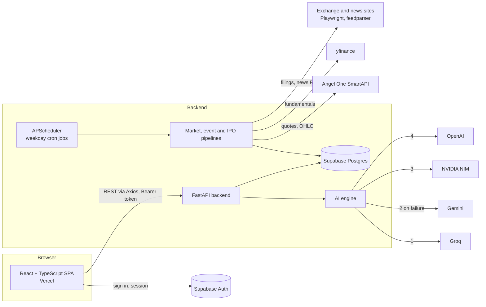

# Stock AI

AI-assisted research for Indian retail investors: stock analysis, IPO evidence, an event radar for your watchlist, screeners and calculators, all for NSE-listed companies.

**Live:** [byteplay.org](https://byteplay.org) · **Frontend:** this repo · **Backend:** FastAPI service (private repo; described below)

**Stack:** React 18 · TypeScript · React Router · Tailwind CSS · Supabase Auth · lightweight-charts · Axios · Vercel
**Backend:** Python · FastAPI · APScheduler · Supabase (Postgres) · Angel One SmartAPI · yfinance · Playwright · Groq / Gemini / NVIDIA NIM / OpenAI

> **Not investment advice.** Stock AI is an educational research tool. It is not registered with SEBI as a research analyst or investment adviser. Talk to a SEBI-registered adviser before making investment decisions.

<!-- Add a 60-second demo GIF here: docs/demo.gif -->

## What it does

| Area | What the user gets |
| --- | --- |
| Stock page (`/stock/:symbol`) | Price chart, fundamentals, recent news and an AI-written analysis with the reasoning and red flags behind it |
| Event radar (`/today`) | A daily brief of results, corporate actions and news for the stocks on your watchlist, plus your own saved investment theses |
| IPOs (`/ipos`) | Upcoming and recent IPOs with evidence pulled from offer documents and filings |
| Screener and dividends (`/stocks`) | Filter NSE stocks; dividend tracker |
| Portfolio and watchlist | Track holdings and watched stocks per signed-in user |
| Tools (`/tools`) | SIP, lumpsum, brokerage and F&O charges calculators; stock comparison |
| Learn (`/learn`) | Nine beginner chapters, from what a stock market is to common mistakes |
| Market wrap and blog | Daily Nifty/Sensex wrap and SEO-friendly articles |

## Architecture



The backend's scheduler runs on weekdays: pre-market analysis at 08:00, a morning digest at 08:30, hourly refreshes from 09:00 to 16:00 during market hours, and a midday re-analysis at 12:30 (IST).

## Engineering decisions

- **LLM provider fallback chain.** Each analysis tries Groq first (fastest), then Gemini, NVIDIA NIM and OpenAI. Free-quota providers go first, so the paid API is used only when the others fail or hit rate limits.
- **Never trust raw model output.** Responses are parsed as JSON, checked for every required field, and the arithmetic in them (quantities, percentages) is recomputed in code before anything reaches the UI. Incomplete answers fall through to the next provider.
- **Pre-computed, not on-demand.** Heavy work (screening, event classification, IPO evidence) runs on a schedule and is stored in Postgres, so page loads read cached results instead of waiting on scrapers or LLMs.
- **Typed API layer.** All backend calls live in `src/lib/api.ts` and `src/lib/investApi.ts`, so components never build URLs by hand.
- **Auth handled by Supabase, data behind the API.** The frontend uses the public anon key only to sign users in. An Axios interceptor attaches the session token to every request, and the backend verifies it with Supabase before reading or writing that user's watchlist, portfolio or theses. The browser never queries the database directly.

## Project structure

```
src/
  components/      pages and UI (StockPage, Dashboard, IPOsPage, StockScreener, tools, learn/)
  lib/api.ts       REST client for the FastAPI backend
  lib/investApi.ts invest-explorer endpoints
  lib/supabase.ts  Supabase client (anon key)
  data/            static catalogues (stock profiles, invest options)
public/            static assets, sitemap, robots.txt
```

## Run locally

```bash
npm install
echo "REACT_APP_API_URL=http://localhost:8000" > .env.local   # backend URL
npm start                                                      # http://localhost:3000
npm test
npm run build
```

## Known limitations

- Test coverage is thin: one smoke test in `App.test.tsx`. Next: tests for `lib/api.ts` and the calculators.
- Built on Create React App, which is no longer maintained; migrating to Vite is planned.
- AI analysis quality depends on the provider that answered; the response does not yet record which model produced it.

## Author

Sujeet Singh · [LinkedIn](https://www.linkedin.com/in/sujeetkarmatix) · [GitHub](https://github.com/Karma-tic)
